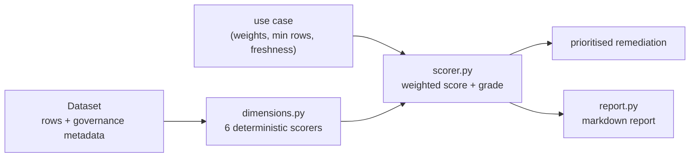

# Jagadish-ai-data-readiness

[](https://github.com/jagadishmazure-jpg/Jagadish-ai-data-readiness/actions/workflows/ci.yml)
[](https://github.com/jagadishmazure-jpg/Jagadish-ai-data-readiness/actions/workflows/codeql.yml)


**Score a dataset's readiness for a specific AI use case before anyone builds a model, with every deduction explained.**

> Personal learning and portfolio project. Everything runs offline on synthetic,
> fictional data with no API keys. Nothing is deployed. Numbers in this README
> come from real runs and are re-checked by CI (`scripts/render_docs.py --check`).

## Recruiter summary

- Discovery-phase tool: six data-readiness dimensions, weighted per AI use case (classification, forecasting, RAG, anomaly detection).
- Explainable: every point lost traces to a named finding and a prioritised fix; same input always gives the same score.
- Standard library only, 37 offline tests, CI with lint, CodeQL, gitleaks and a check that documented output matches a fresh run.

## Purpose

Most enterprise AI projects stall on the data, not the model: key columns half
empty, stale extracts, too few rows, no labels, and nobody has recorded where the
data came from or whether it holds personal data. This repo turns that discovery
conversation into a repeatable score. You point it at a dataset and an intended
use case, and it tells you how ready the data is, why, and what to fix first.

## Architecture



## How it works

| Dimension | What it measures |
|---|---|
| Completeness | Missing-value rate per column; key columns count more |
| Label quality | Label presence, null rate and class balance (supervised use cases only) |
| Freshness | Age of the newest record against the cadence the use case needs |
| Volume | Row count against a minimum for the model class |
| Distribution | Skew, constant columns, duplicate rows |
| Governance | Classification, lineage, residency and PII declarations in the metadata |

Weights differ by use case: label quality carries no weight for RAG, and freshness
dominates forecasting. The overall score is the weighted sum, graded A to F.
Recommendations are ordered by how many weighted points each fix would recover.
The full scoring spec is in [docs/methodology.md](docs/methodology.md).

The demo below shows the governance dimension doing its job: the same rows score
89.4 (B) with governance metadata and 74.4 (C) without it.

## Real code and output

```python
"""Score the same synthetic datasets for different AI use cases (offline, deterministic)."""
from readiness import Dataset, assess, make_customer_churn, make_meter_telemetry, make_support_docs

cases = [
    (make_customer_churn(quality="good"), "tabular_classification"),
    (make_customer_churn(quality="missing"), "tabular_classification"),
    (make_customer_churn(quality="unlabeled"), "tabular_classification"),
    (make_meter_telemetry(quality="stale"), "forecasting"),
    (make_support_docs(quality="good"), "rag_documents"),
    (make_support_docs(quality="tiny"), "rag_documents"),
]
print(f"{'dataset':28} {'use case':24} {'score':>6} grade")
for ds, uc in cases:
    r = assess(ds, uc)
    print(f"{ds.name:28} {uc:24} {r.overall:6.1f} {r.grade}")

# Same rows, but nobody filled in the governance metadata.
missing = make_customer_churn(quality="missing")
ungoverned = Dataset(name="customer_churn_ungoverned", rows=missing.rows, metadata={})
r = assess(ungoverned, "tabular_classification")
print(f"\n{r.dataset_name}: {r.overall:.1f} {r.grade}  (same rows, governance metadata removed)")
for d in r.dimensions:
    print(f"  {d.name:14} {d.score:6.1f}  findings={len(d.findings)}")
print("Top remediation steps:")
for step in r.recommendations[:5]:
    print("  -", step)
```

Output of `python examples/demo.py` (real run, re-checked in CI):

<!-- run: python examples/demo.py -->
```text
dataset                      use case                  score grade
customer_churn_good          tabular_classification    100.0 A
customer_churn_missing       tabular_classification     89.4 B
customer_churn_unlabeled     tabular_classification     85.0 B
meter_telemetry_stale        forecasting                75.0 C
support_docs_good            rag_documents             100.0 A
support_docs_tiny            rag_documents              84.0 B

customer_churn_ungoverned: 74.4 C  (same rows, governance metadata removed)
  completeness     57.5  findings=3
  label_quality   100.0  findings=0
  freshness       100.0  findings=0
  volume          100.0  findings=0
  distribution    100.0  findings=0
  governance        0.0  findings=4
Top remediation steps:
  - [governance] declare a classification (public / internal / confidential / restricted) in dataset metadata
  - [governance] record the upstream source and extract version in dataset metadata
  - [governance] declare the residency zone (e.g. EU / US / APAC) so residency policies can be enforced
  - [governance] declare 'email' in pii_columns and confirm masking, consent and access controls
  - [completeness] backfill or impute 'tenure_months' (10% missing); drop the column if it is not predictive
```
<!-- /run -->

## How to run

```bash
git clone https://github.com/jagadishmazure-jpg/Jagadish-ai-data-readiness.git
cd Jagadish-ai-data-readiness
python -m pip install pytest      # the package itself is stdlib-only
python -m pytest -q          # offline, no keys
python examples/demo.py
python scripts/render_docs.py --check   # documented output still matches
```

Test suite size (real collection, re-checked in CI):

<!-- run: python scripts/count_tests.py -->
```text
37 tests collected
```
<!-- /run -->

## Guardrails

- Deterministic scoring: no randomness, no model calls, so a score can be reproduced in an audit.
- Governance is scored like any quality signal; missing classification, lineage, residency or PII declarations cost points.
- The tool reads data and metadata only; it never modifies or exports the dataset.
- Synthetic generators are clearly named and used only for demos and tests.

## Limitations

- Thresholds are hand-set heuristics, not learned from outcomes; they need calibrating per organisation.
- Rows are in-memory Python dicts, so very large tables need sampling first.
- Governance checks look for declarations in metadata; they cannot prove the declarations are true.
- Four use cases are built in; others need their own weight profile.

## Built vs planned

| Capability | Status | Where |
|---|---|---|
| Six dimension scorers and use-case weighting | Built | `readiness/dimensions.py`, `readiness/scorer.py` |
| Markdown report and prioritised remediation | Built | `readiness/report.py` |
| Synthetic churn, telemetry and document datasets | Built | `readiness/dataset.py` |
| Readers for Fabric Lakehouse / ADLS tables | Planned | docs/implementation-guide.md |
| Purview metadata as the governance source | Planned | docs/implementation-guide.md |
| Learned thresholds from past project outcomes | Planned | not started |

## Implementation guide

The step-by-step path from this offline build to an Azure deployment is in
[docs/implementation-guide.md](docs/implementation-guide.md). None of it has been
run; it is a plan.

## Related repositories

| Repo | How it relates |
|---|---|
| [Jagadish-agentic-data-layer](https://github.com/jagadishmazure-jpg/Jagadish-agentic-data-layer) | Data contracts and quality gates for AI-ready data products; this repo is the assessment you run before building them |
| [Jagadish-ai-maturity-assessment](https://github.com/jagadishmazure-jpg/Jagadish-ai-maturity-assessment) | Organisation-level AI maturity; this repo scores a single dataset |
| [Jagadish-fabric-enterprise-bi](https://github.com/jagadishmazure-jpg/Jagadish-fabric-enterprise-bi) | Medallion Lakehouse that a planned Fabric reader would score |
| [Jagadish-text2sql-data-agent](https://github.com/jagadishmazure-jpg/Jagadish-text2sql-data-agent) | Consumes structured data that should pass this check first |

## Documentation

- [Scoring methodology](docs/methodology.md)
- [Implementation guide (Azure)](docs/implementation-guide.md)
- [Interview points](docs/interview-points.md)
- [Security policy](SECURITY.md)

## Project layout

```
readiness/
  dataset.py      Dataset model + synthetic generators (churn, telemetry, docs)
  dimensions.py   six deterministic scorers (stdlib only)
  scorer.py       use-case weighting, grading, remediation ordering
  report.py       markdown rendering
examples/demo.py  the run shown above
scripts/          render_docs.py (doc drift check), count_tests.py
tests/            offline pytest suite
docs/             methodology, implementation guide, interview points
```

## License

MIT, see [LICENSE](LICENSE). All data is synthetic; every organisation and person is fictional.
